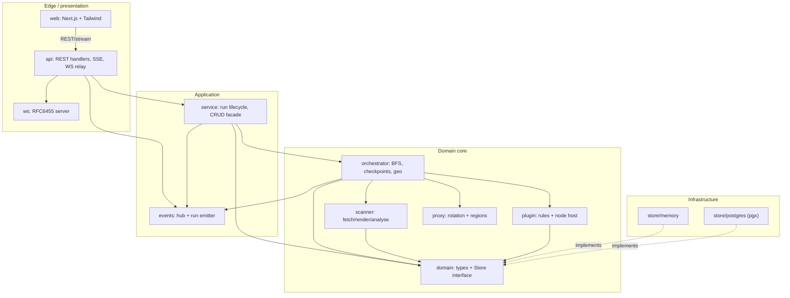
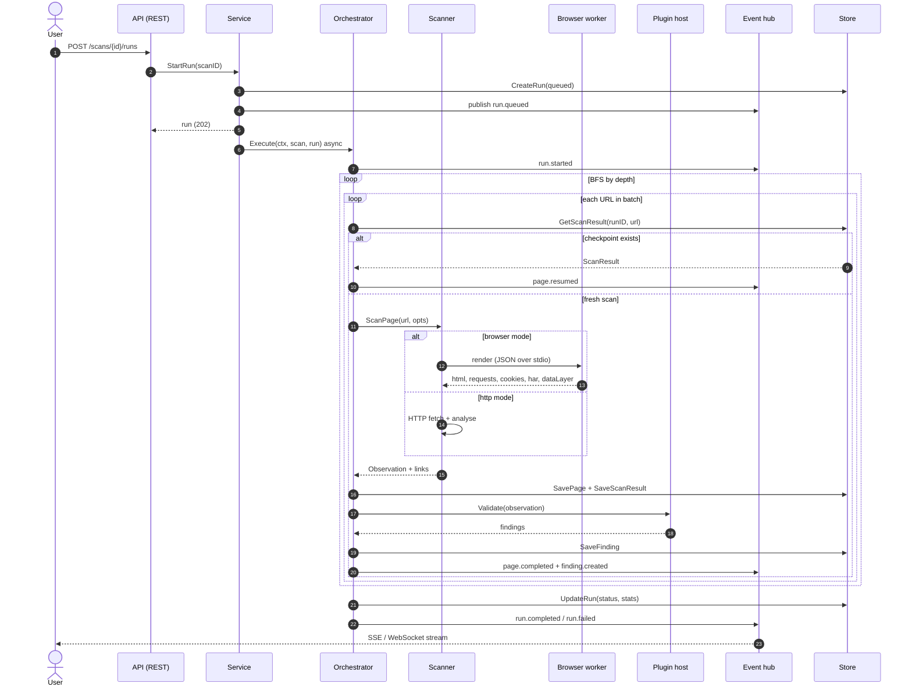
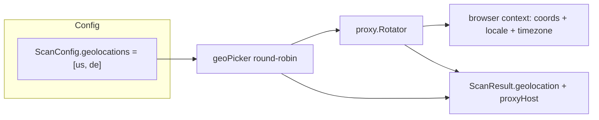
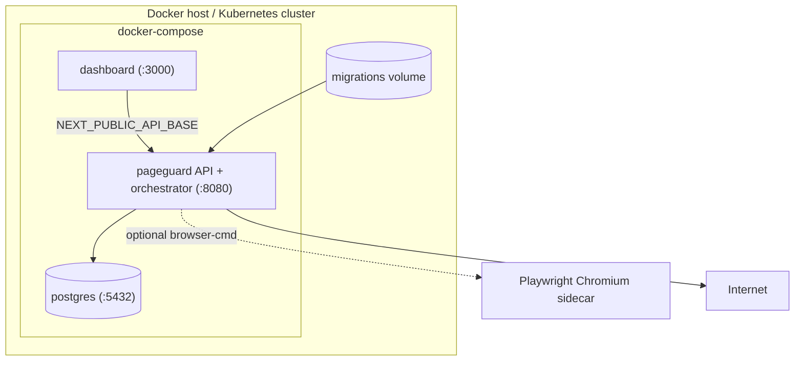
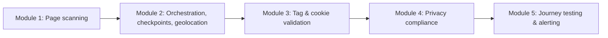

# Pageguard — High-Level Design (HLD)

## 1. Purpose

Pageguard is a self-hostable web-governance and martech-auditing platform. It
crawls a site, renders pages in a real browser, detects tags/cookies/third-party
requests, and validates what it finds against a plugin-based rule engine. Output
is a stream of findings plus a per-page evidence record (`ScanResult`).

This document describes the system **as built** at the component level. See
`docs/low-level-design.md` for types, algorithms and persistence detail.

## 2. Goals & constraints

| Goal | Notes |
| --- | --- |
| Crawl + render | HTTP fetch and headless-browser render (`http`/`browser`/`auto`). |
| Evidence | Tags, cookies (hash only), requests, DOM, HAR, data layer. |
| Cross-border | Observe a page from multiple geolocations via region proxies. |
| Resumable | Per-page checkpoints; re-running is idempotent. |
| Extensible | TypeScript plugin SDK; declarative + out-of-process Node rules. |
| Streamable | Live progress over SSE + WebSocket. |
| Deployable | Single Go binary; Docker Compose + Helm; PostgreSQL storage. |

Hard constraints: Go backend, PostgreSQL, Next.js + Tailwind dashboard,
REST + WebSocket API, Docker Compose + Helm. The Go core depends only on the
standard library except `jackc/pgx` (isolated in `internal/store/postgres`).

## 3. System context

```mermaid
flowchart TB
  subgraph Actors
    OP["Operator (browser)"]
    CI["CI / scheduler"]
  end

  subgraph Platform["Pageguard platform"]
    DASH["Next.js dashboard"]
    API["REST + SSE/WS API"]
    SVC["Service layer"]
    ORCH["Orchestrator"]
    SCANNER["Scanner"]
    HOST["Plugin host"]
    HUB["Event hub"]
    STORE["domain.Store"]
  end

  PGDB[("PostgreSQL")]
  WORKER["Playwright worker (Node)"]
  WEB["Target websites"]
  PROXY["Regional egress proxies"]

  OP --> DASH
  DASH -->|"REST + SSE/WS"| API
  CI -->|"REST"| API
  API --> SVC
  SVC --> ORCH
  API --> HUB
  SVC --> STORE
  ORCH --> SCANNER
  ORCH --> HOST
  ORCH --> HUB
  ORCH --> STORE
  SCANNER --> WEB
  SCANNER --> PROXY
  SCANNER -->|"stdio JSON"| WORKER
  WORKER --> WEB
  WORKER --> PROXY
  STORE --> PGDB
```

## 4. Logical layers

Dependency direction is strict: `domain` imports nothing from the project;
`scanner`, `plugin`, `events`, `proxy` depend on `domain`; `orchestrator`
depends on all of them; `service` on `orchestrator`; `api` on `service` +
`plugin`; `cmd` wires everything.

## 5. End-to-end scan flow

## 6. Cross-border collection (multi-geolocation)

Each page is pinned to a region; the region selects an egress proxy and drives
the browser context, so the resulting evidence records the vantage point.

## 7. Deployment topology

The API runs as a non-root container and applies migrations on startup. It is
stateless apart from PostgreSQL, but live streaming uses an in-memory hub, so a
stream must reach the replica that owns the run (single replica for live
streams until a shared event bus is added).

## 8. Module roadmap

Modules 1–2 are implemented. Within Modules 3–5 the policy-based tag-validation
engine (`internal/tagpolicy`), the journey tester (`internal/journey`) and the
privacy compliance engine (`internal/privacy`, consent-state simulation) are
delivered; the remaining work (browser-based rescanner, alerting, wiring) is
designed in `docs/roadmap.md`.

## 9. Quality attributes

- **Reliability:** per-page checkpoints + idempotent resume; a page failure never
  aborts the run; plugin errors are isolated per validator.
- **Security:** raw cookie values hashed before storage; out-of-process plugins
  run with no ambient credentials; request bodies capped and unknown JSON fields
  rejected.
- **Performance:** bounded per-depth worker pool; level-synchronized BFS;
  non-blocking event fan-out so a slow client cannot stall a scan.
- **Extensibility:** `Fetcher`, `Renderer`, `Store` and `pluginsdk.Validator`
  are the seams; production and test implementations swap freely.
