# Pageguard — Low-Level Design (LLD)

Companion to `docs/high-level-design.md`. This document details packages, types,
algorithms, persistence and concurrency. All diagram labels reflect the code in
`D:\openobserve`.

## 1. Package dependency graph

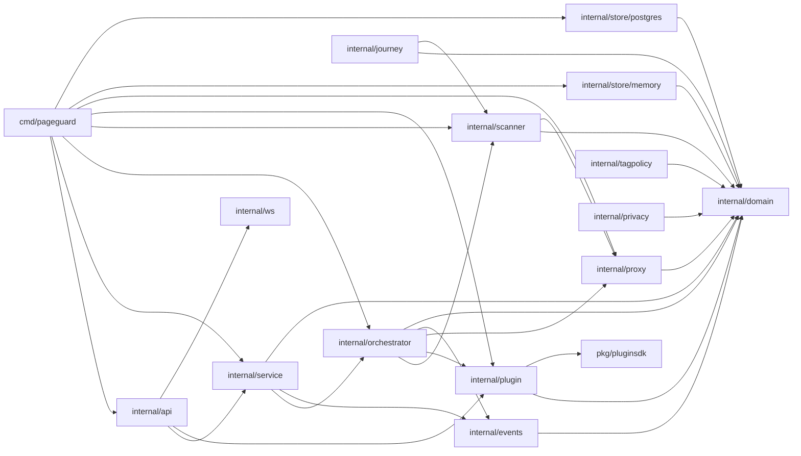

## 2. Domain model

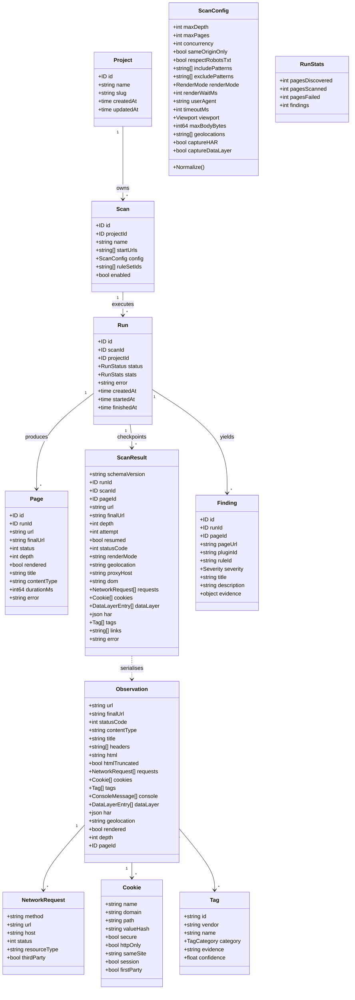

## 3. Identifiers and enums

- `domain.ID` is a 32-character lowercase hex string (`NewID()`); PostgreSQL
  stores it as `uuid` via `toUUID` / `toID` (dashless accepted, normalized).
- `RenderMode`: `http` | `browser` | `auto`.
- `RunStatus`: `queued` | `running` | `succeeded` | `failed` | `canceled`.
- `Severity`: `info` | `low` | `medium` | `high` | `critical`.
- `TagCategory`: `analytics` | `advertising` | `tag_manager` | `cdp` |
  `consent` | `monitoring` | `unknown`.

## 4. Run state machine

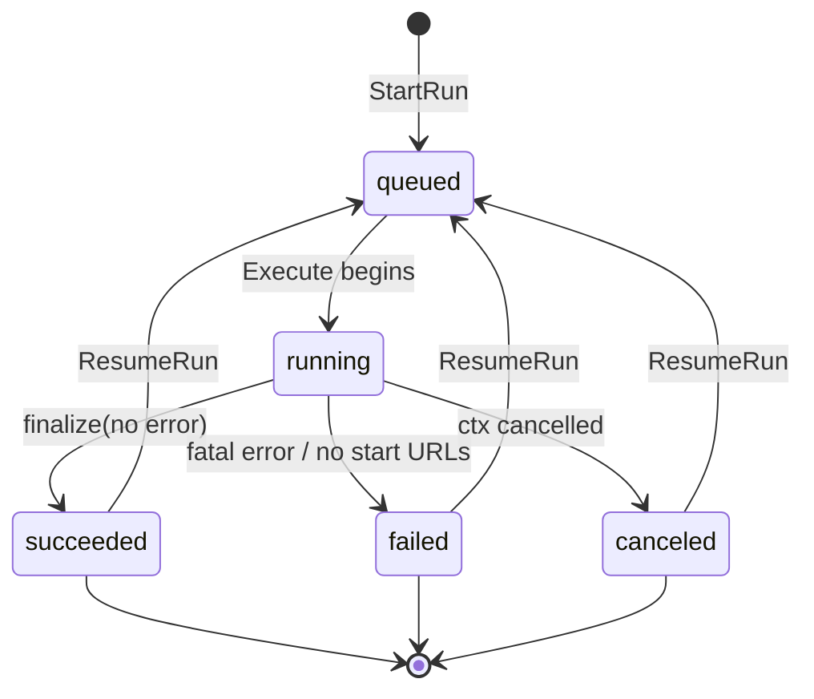

## 5. Orchestrator (`internal/orchestrator`)

`Manager` fields: `store domain.Store`, `hub *events.Hub`,
`scanner *scanner.Scanner`, `plugins *plugin.Host`, `rotator *proxy.Rotator`,
`captureHAR`, `captureDataLayer`. Options: `WithProxyRotator`, `WithCapture`.

### 5.1 Execute algorithm

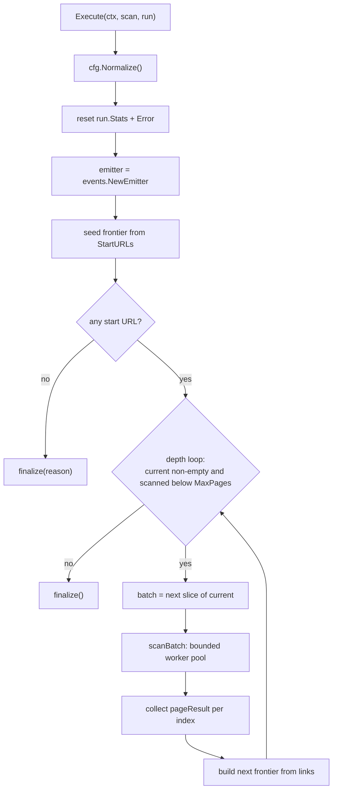

### 5.2 scanOne: checkpoint or fresh

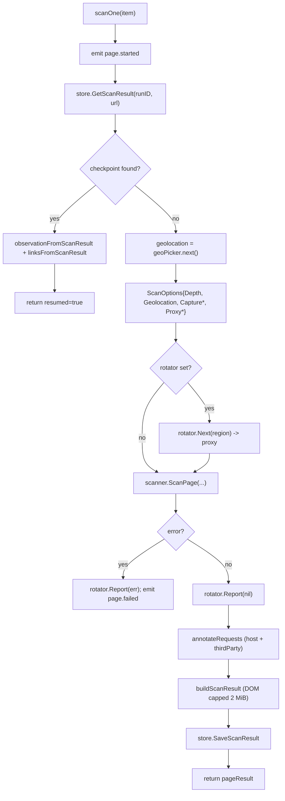

### 5.3 finalize: reconciled statistics

`finalize` sets the terminal status, then **reconciles** `PagesScanned`,
`PagesFailed` and `Findings` from the store (`ListPages` + `ListFindings`) so a
resumed run reports the same totals as a fresh one. `PagesDiscovered` comes from
the emitter (rebuilt during traversal).

### 5.4 Scope decisions

`allowURL` applies, in order: scheme (`http`/`https`), same-origin policy,
include globs, exclude globs, then `robots.txt` (user-agent aware, longest
match, wildcards, `$`). The `geoPicker` uses an atomic counter for lock-free
round-robin across workers.

## 6. Scanner (`internal/scanner`)

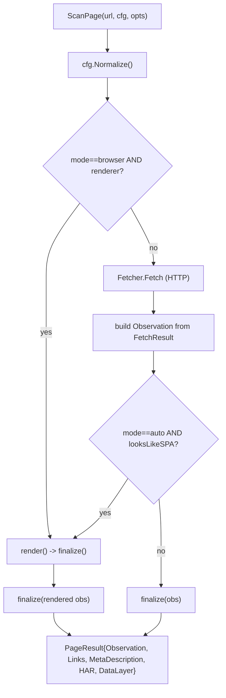

Key helpers:

- `cookiesFromHeaders` / worker cookie mapping → `Cookie` with `hashValue`
  (SHA-256 truncated to 8 bytes → 16 hex chars). Raw values never leave the edge.
- `ExtractLinks(base *url.URL, html)` returns `Links{Documents,...}` used for the
  frontier; `ExtractMetaDescription`, `ExtractTitle`.
- `LooksLikeSPA` drives `auto` upgrade; browser failure leaves the HTTP result.
- Renderers implement `Renderer` (`Render`, `Close`): `BrowserRenderer` speaks
  newline-delimited JSON to `tools/browser-renderer/index.mjs`; `FakeRenderer`
  serves tests.

### 5.4 Render worker protocol

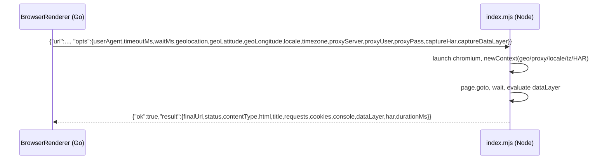

## 6. Proxy & geolocation (`internal/proxy`)

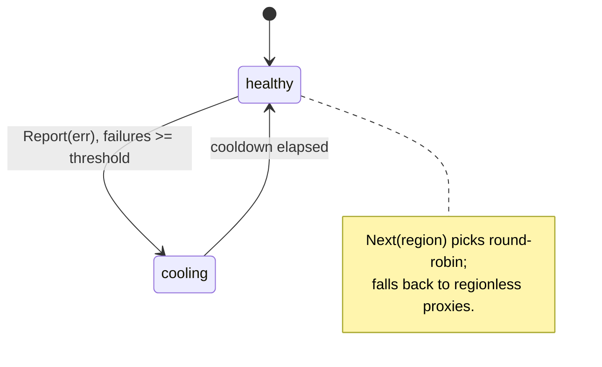

- `Region` catalog (`us`, `ca`, `uk`, `ie`, `de`, `fr`, `nl`, `au`, `jp`, `sg`,
  `in`, `br`) maps labels to coordinates, locale and timezone.
- `Rotator.Next(region)` selects a healthy proxy for the region; `Report(err)`
  increments failures and applies a cooldown threshold.
- `ParseProxies` parses `region=scheme://host:port` specs with region inheritance
  from the previous entry.
- `RoundTripper` reads the region from context (`WithRegion`) and retries up to
  `MaxAttempts`.

## 7. Plugin host (`internal/plugin`)

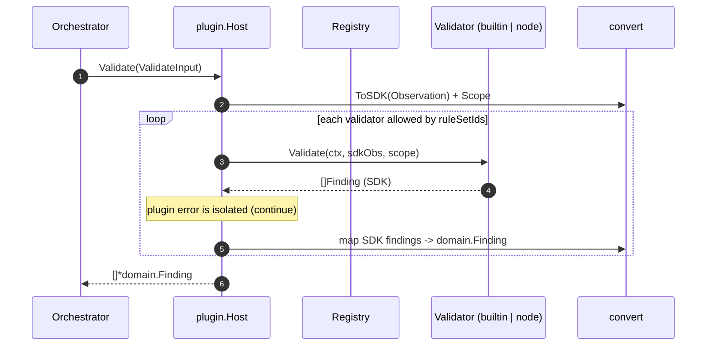

- `runtime: builtin` — `ruleengine` evaluates declarative `RuleSpec` predicates
  against the SDK observation.
- `runtime: node` — `node.go` spawns a child process and speaks one-shot JSON
  over stdio (`pluginsdk.ProtocolVersion = 1`).
- `loader` reads each plugin directory's `manifest.json`.

## 8. Events & streaming (`internal/events`, `internal/api`, `internal/ws`)

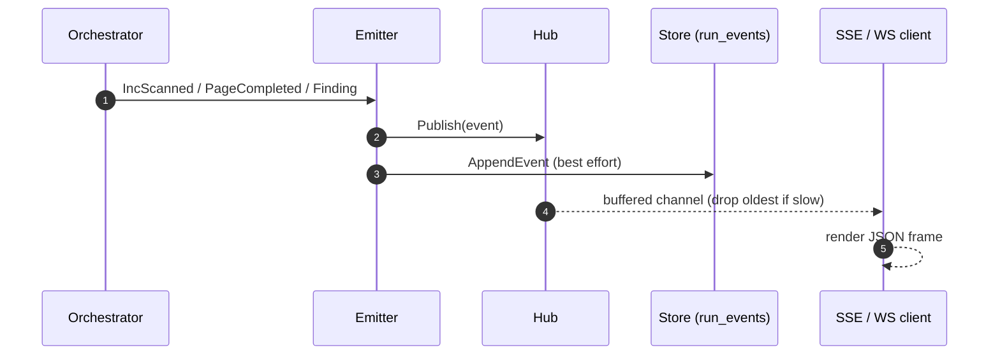

- `Hub` fan-out is non-blocking with a 256-event per-subscriber buffer;
  `dropped` counts overflow. Each event carries a monotonic global ID.
- `api` exposes both `GET /runs/{id}/events` (SSE) and
  `GET /runs/{id}/stream` (WebSocket) over the same payloads.
- Event types include `run.queued`, `run.started`, `page.discovered`,
  `page.started`, `page.completed`, `page.resumed`, `page.failed`,
  `finding.created`, `run.completed`, `run.failed`, `log`.

## 9. Persistence

`domain.Store` is the contract; `internal/store/memory` (maps + mutexes) and
`internal/store/postgres` (pgx) implement it.

### 9.1 Store interface

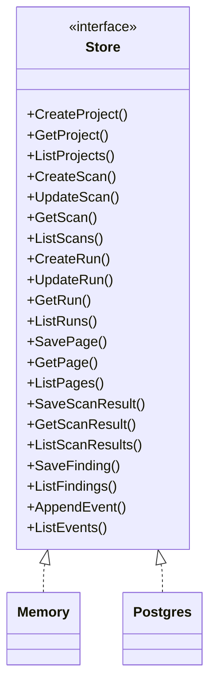

### 9.2 Relational schema (ER)

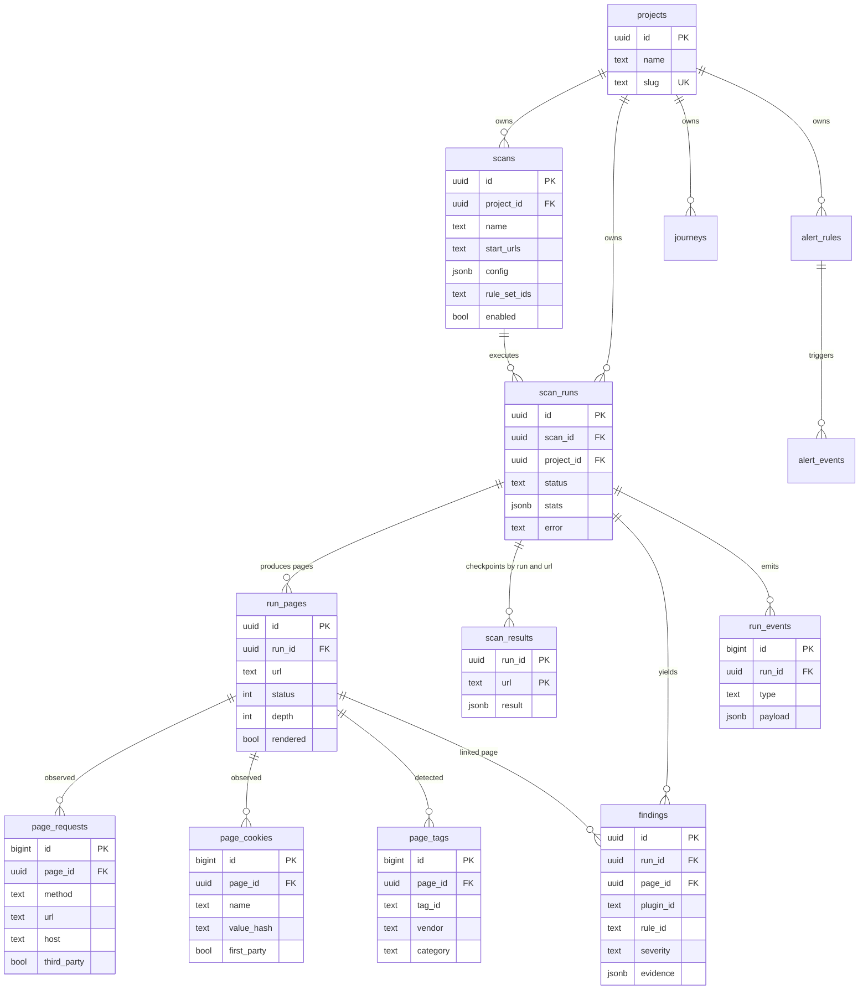

### 9.3 ScanResult checkpoint semantics

- Keyed by `(run_id, url)` with an upsert, so re-execution is idempotent.
- Stored as a single `jsonb` column matching `schemas/scanresult.schema.json`
  (version `ScanResultSchemaVersion = "1.0.0"`).
- DOM is capped at `maxStoredDOM = 2 MiB`; the raw HTML length is kept in
  `domBytes` and truncation is flagged by `domTruncated`.
- Cookie values are stored only as `valueHash` (SHA-256 truncated to 8 bytes →
  16 hex chars).

## 10. HTTP API

| Method | Path | Handler |
| --- | --- | --- |
| GET | `/healthz` | `handleHealth` |
| GET/POST | `/api/v1/projects` | `handleListProjects` / `handleCreateProject` |
| GET/POST | `/api/v1/scans` | `handleListScans` / `handleCreateScan` |
| GET | `/api/v1/scans/{id}` | `handleGetScan` |
| POST | `/api/v1/scans/{id}/runs` | `handleStartRun` |
| GET | `/api/v1/runs/{id}` | `handleGetRun` |
| POST | `/api/v1/runs/{id}/cancel` | `handleCancelRun` |
| POST | `/api/v1/runs/{id}/resume` | `handleResumeRun` (409 if in flight) |
| GET | `/api/v1/runs/{id}/pages` | `handleListPages` |
| GET | `/api/v1/runs/{id}/results` | `handleListResults` |
| GET | `/api/v1/runs/{id}/result?url=` | `handleGetResult` |
| GET | `/api/v1/runs/{id}/findings` | `handleListFindings` |
| GET | `/api/v1/runs/{id}/events` | `handleSSE` |
| GET | `/api/v1/runs/{id}/stream` | `handleWS` |
| GET | `/api/v1/plugins` | `handleListPlugins` |

## 11. Concurrency & error handling

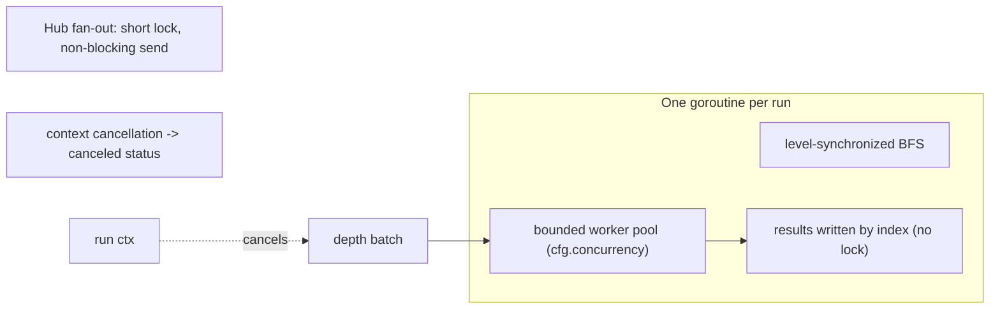

- **One goroutine per run**; runs are independent.
- **Bounded worker pool per depth**; results written to a pre-sized slice by
  index (no result locking). Level-synchronized BFS gives deterministic
  accounting and deadlock-free scheduling.
- **Event fan-out** never blocks the producer.
- **Error handling:** page errors are recorded (`PagesFailed`) and do not abort
  the run; only bad configuration/cancellation is fatal; plugin errors are
  isolated per validator.

## 11. Extension points

| Seam | Interface | Production | Test |
| --- | --- | --- | --- |
| Fetch | `scanner.Fetcher` | `HTTPFetcher` | `fakeFetcher` |
| Render | `scanner.Renderer` | `BrowserRenderer` | `FakeRenderer` / recording |
| Persist | `domain.Store` | `store/postgres` | `store/memory` |
| Rules | `pluginsdk.Validator` | builtin + Node plugins | ruleengine tests |
| Proxy | `proxy.Rotator` | `proxy.Rotator` | rotator tests |

## 11.1 Configuration defaults (`ScanConfig.Normalize`)

| Field | Default |
| --- | --- |
| `MaxDepth` | 3 |
| `MaxPages` | 500 |
| `Concurrency` | 4 |
| `RenderMode` | `http` |
| `TimeoutMs` | 20000 |
| `MaxBodyBytes` | 4 MiB |
| `Viewport` | 1366 × 768 |
| `UserAgent` | `PageguardBot/0.1 (+https://github.com/pageguard/pageguard)` |

## 11. Testing map

| Package | Coverage |
| --- | --- |
| `internal/proxy` | catalog, `ParseProxies`, round-robin, cooldown, dead proxy |
| `internal/scanner` | HTTP extraction, tags/cookies, geo/proxy/capture propagation |
| `internal/orchestrator` | BFS, scope/robots, resume idempotency, geo+proxy |
| `internal/plugin` | rule engine, node host, loader |
| `internal/store/memory` | CRUD + `ScanResult` upsert |
| `internal/store/postgres` | full round-trip (gated on `PAGEGUARD_TEST_DATABASE_URL`) |
| `internal/domain` | `ScanResult` JSON round-trip + schema contract |
| `internal/tagpolicy` | policy load (YAML/JSON), value rules, duplicates/orphans, consent, report + schema lockstep |
| `internal/journey` | journey load (YAML/JSON), step execution pass/fail/error, per-step diffs, data-layer events, worker protocol + schema lockstep |
| `internal/privacy` | policy load (YAML/JSON), consent-state simulation, per-regulation checks, scoring, flags, findings + schema lockstep |
| `internal/api`, `internal/events`, `internal/ws` | handlers, hub fan-out, RFC6455 |
